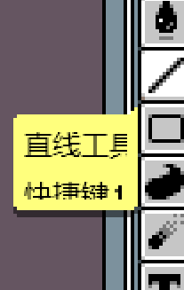
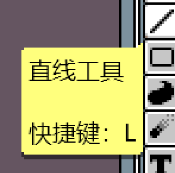

# aseprite-chinese-fix 中文插件修复版

用于修复 Aseprite 中文字体显示问题的主题扩展，包含浅色和深色两种配色。

## 修复效果

| 修复前 | 修复后 |
| --- | --- |
|  |  |

## 修复内容

- 中文字符使用抗锯齿 TrueType 回退字体，英文字符仍保留 Aseprite 原生像素字体。
- 按系统选择字体：Windows 使用微软雅黑 `msyh.ttc`，macOS 使用苹方 `PingFang.ttc`，Linux 使用思源黑体 `NotoSansCJK-Regular.ttc`。
- 常规界面的中文回退字号设为 `8`，迷你控件设为 `6`，避免中文过大、超出紧凑控件。
- 悬停提示框单独使用 `CNFont`，确保排版测量和实际绘制使用同一字体，修复提示文字超出背景框的问题。
- 浅色 `cn-clear` 与深色 `cn-clear-dark` 主题已同步应用全部修复。

## 安装

1. 从 Releases 下载 `aseprite-chinese-fix-1.2.1.aseprite-extension`。
2. 在 Aseprite 中打开“编辑 > 首选项 > 扩展”。
3. 点击“添加扩展”，选择下载的文件。
4. 在“编辑 > 首选项 > 主题”中选择 `cn-clear` 或 `cn-clear-dark`。
5. 重新启动 Aseprite，使字体资源完整加载。

也可以将仓库内容复制到 Aseprite 的扩展目录。便携版通常位于程序目录下的 `extensions` 或 `data/extensions`。

## 兼容性

当前主题基于 Aseprite 1.3.18 系列的默认主题资源制作。其他 1.3.x 版本通常也可以使用，但新增控件可能沿用默认主题样式。

## 说明

扩展不会分发操作系统字体，而是加载系统已有字体。若 Linux 系统未安装 `NotoSansCJK-Regular.ttc`，请先安装对应的思源黑体/Noto CJK 字体。

## 许可

主题资源基于 Aseprite Default Theme，并依照 [Creative Commons Attribution 4.0](LICENSE.txt) 许可发布。
